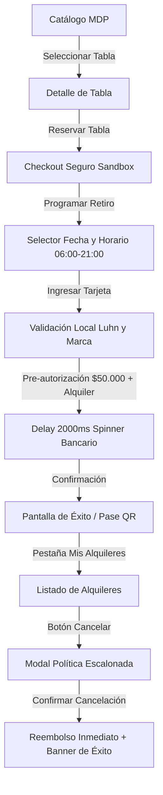

# Flujo Completo de Reserva, Pago Sandbox y Cancelación Escalonada
## Surf Rental Mar del Plata (Monorepo MVP)

Este documento detalla la arquitectura, validaciones y pantallas que conforman el ciclo de vida de un alquiler de tablas en la plataforma.

---

## 1. Diagrama del Flujo de Usuario y Estados

---

## 2. Etapas del Flujo

### Etapa 1: Exploración y Catálogo Responsive
- **Pantalla**: `CatalogScreen.tsx`
- **Capacidades**:
  - Filtros por tipo de tabla: *Longboard, Fish, Funboard, Shortboard, SUP*.
  - Grilla responsiva adaptativa: 1 columna en móvil (<600px), 2 columnas en tablet (600-1024px), 3 columnas en desktop (>1024px).
  - Acceso directo a "Ver Detalle" o "Reservar".

### Etapa 2: Detalle Técnico de la Tabla
- **Pantalla**: `BoardDetailScreen.tsx`
- **Capacidades**:
  - Carrusel horizontal de fotografías de la tabla con blurhash placeholder.
  - Especificaciones técnicas: volumen en litros, medidas, valor tasado en USD (Agencia), sede de retiro (Playa Grande).
  - CTA principal sticky: "Reservar Tabla" con precio base y tiempo estimado.

### Etapa 3: Checkout con Tarjeta de Débito (Modo Sandbox / Simulado)
- **Pantalla**: `CheckoutScreen.tsx`
- **Subcomponentes y Utilidades**:
  - `DatePickerInput.tsx`: Selector interactivo de fecha con modal, navegación de meses y años, restringido entre *hoy* y *hoy + 90 días*.
  - **Selector de Horarios**: Intervalos de 30 minutos entre **06:00 y 21:00 hs** (horario de operación de la sede).
  - **Desglose Transparente**: Subtotal por horas elegidas (2h, 4h, 8h con 25% OFF), depósito de garantía pre-autorizado de $50.000 ARS (liberado al devolver la tabla).
  - **Banner Obligatorio**: *"Solo aceptamos TARJETA DE DÉBITO. No aceptamos crédito."*
  - **Validación en Vivo de Tarjeta** (`mobile/src/utils/cardValidation.ts`):
    - **Algoritmo de Luhn**: Checksum mod 10 en tiempo real con feedback visual (icono verde ✅).
    - **Detección Automática de Marca**:
      - Visa: Empieza con `4` $\rightarrow$ Badge `[VISA]` (Azul marino).
      - Mastercard: Rangos 51-55 y 2221-2720 $\rightarrow$ Badge `[MASTERCARD]` (Rojo).
      - American Express: Empieza con 34 o 37 $\rightarrow$ Badge `[AMEX]` (Celeste).
    - **Formateadores on-change**: Espaciado cada 4 dígitos, fecha de expiración con `/` automático (`MM/AA`), CVV dinámico (3 o 4 dígitos para Amex) y DNI numérico hasta 8 dígitos.
    - **Protección de Datos Sensibles**: **NUNCA** se almacena en base de datos el número completo, CVV ni vencimiento. Únicamente se persiste los últimos 4 dígitos y la marca.
  - **Procesamiento Asíncrono**: Spinner bancario con delay de 2000ms antes de emitir el comprobante.
  - **Aviso Legal**: *"Transacción simulada en entorno de desarrollo. No se realizan cobros reales. Conforme a la Ley 24.240 de Defensa del Consumidor."*

### Etapa 4: Confirmación y Pase de Retiro QR
- **Pantalla**: `CheckoutScreen.tsx` (Estado de éxito) & `MyRentalsScreen.tsx` (Modal QR)
- **Capacidades**:
  - Badge distintivo: `PAGO SIMULADO — MODO DEV`.
  - Comprobante con número único `#MDP-XXXXXX`, tarjeta `•••• XXXX (MARCA)`, monto pagado y garantía pre-autorizada.
  - Pase de retiro con código QR mockup y aviso de enjuague de tabla.

### Etapa 5: Cancelación Escalonada con Reembolso
- **Pantalla**: `MyRentalsScreen.tsx` & Backend `POST /api/rentals/:id/cancel`
- **Política Escalonada**:
  - **Más de 72 hs antes**: Reembolso del 100%.
  - **24 a 72 hs antes**: Reembolso del 70% (30% penalidad / retención por costo de oportunidad).
  - **6 a 24 hs antes**: Reembolso del 40% (60% retención).
  - **Menos de 6 hs antes**: 0% reembolso (100% penalidad).
- **Manejo del Flujo**:
  - Al presionar "Cancelar", se abre modal con advertencia y detalles de la política.
  - Al presionar "Confirmar Cancelación":
    - Spinner `isLoading` en el botón y bloqueo contra doble click.
    - Disparo de vibración táctil vía `expo-haptics` (`Haptics.impactAsync`).
    - Cierre inmediato del modal para garantizar respuesta fluida en React Native Web y móvil.
    - Banner de confirmación en la parte superior con detalle exacto del reembolso y porcentaje obtenido.
    - Actualización inmediata del badge del alquiler a `CANCELADA`.

---

## 3. Registro de Screenshots Verificados

| Paso | Archivo | Descripción |
|---|---|---|
| **01** | `screenshots/10_cancel_modal_open.png` | Modal de confirmación de cancelación con desglose de política escalonada |
| **02** | `screenshots/11_cancel_success_banner.png` | Alquiler cancelado con banner de éxito y badge actualizado |
| **03** | `screenshots/12_datepicker_modal_open.png` | Modal de calendario interactivo DatePickerInput con navegación de año y mes |
| **04** | `screenshots/13_datepicker_under_18_error.png` | Error visual amigable en registro al seleccionar fecha menor de 18 años |
| **05** | `screenshots/14_datepicker_valid_selected_age.png` | Fecha formateada ("15 de enero de 1998") y badge de edad calculada |
| **06** | `screenshots/15_checkout_summary.png` | Resumen de tabla, duración, selector de sede y precio breakdown |
| **07** | `screenshots/16_checkout_card_brand_detected.png` | Tarjeta Visa ingresada con checksum Luhn válido y badge azul |
| **08** | `screenshots/17_checkout_processing_spinner.png` | Botón en estado de carga con spinner durante la simulación bancaria |
| **09** | `screenshots/18_checkout_success_confirmation.png` | Comprobante de pago con badge MODO DEV y máscara de últimos 4 dígitos |

---

## 4. Resultados de Verificación de Tests

### Backend API (Express + Prisma + MySQL)
- **Suites**: 14/14 pasando (100%)
- **Tests**: 108/108 pasando (100%)
- **Módulos auditados**: Auth, Rentals (Cálculo de reembolsos, cancelaciones y validaciones), Loyalty, Legal (Hashes SHA-256 Ley 25.506), Claims, Payments.

### Mobile App (React Native + Expo + Redux Toolkit + Zod)
- **Suites**: 4/4 pasando (100%)
- **Tests**: 37/37 pasando (100%)
- **Módulos auditados**: `cardValidation.test.ts` (Luhn mod 10, marcas Visa/MC/Amex, vencimientos, formateadores), `auth.schema.test.ts` (validación estricta de nombres y fecha de nacimiento), `authSlice.test.ts`, `logoutThunk.test.ts`.

### Playwright E2E Tests
- **Total tests**: 8/8 pasando (100%)
  1. `auth-flow.spec.ts` (Login, 3 roles, logout)
  2. `cancel-rental.spec.ts` (Cancelación escalonada con modal y banner)
  3. `checkout-card.spec.ts` (Checkout con débito mock, Luhn, brand y delay bancario)
  4. `datepicker-register.spec.ts` (DatePicker interactivo, año/mes/día y +18)
  5. `responsive-catalog.spec.ts` - Mobile (1 col)
  6. `responsive-catalog.spec.ts` - Tablet (2 col)
  7. `responsive-catalog.spec.ts` - Desktop (3 col)
  8. `validation-flow.spec.ts` (Validación estricta de formulario de registro)
